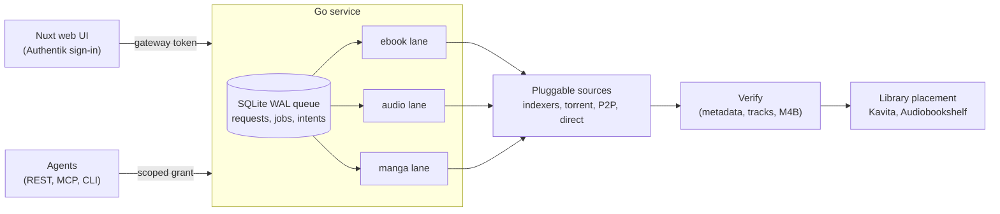

# Arrdio

**A self-hosted request manager for ebooks, audiobooks and manga, built for the \*arr stack.**

Type a title (or snap a photo of a bookshelf). Arrdio queues the request, searches
your configured sources, picks the best release, checks the file, and files it into
Kavita or Audiobookshelf under the names those libraries expect. If nothing turns
up, it waits and tries again on a schedule. Requests live in a durable SQLite queue,
so a restart, a crashed download or a closed browser tab never loses one.

> **Arrdio was created by Ashwin ([@ashkaty](https://github.com/ashkaty)).** His
> original app (Nuxt UI, Go API, search-and-download across several sources,
> download categories, Authentik login) is the foundation of everything here, and
> his commits are preserved in this repository's history. This repository is
> [Joey Hersh](https://github.com/joey12725)'s fork, which rebuilds acquisition
> around a durable job queue. See [What the fork adds](#what-the-fork-adds).



## Features

- **One request, every format.** A book gets independent ebook and audiobook jobs;
  manga gets volume-aware jobs. Each one moves through its own lifecycle and retries
  on its own.
- **Durable queue.** SQLite in WAL mode with leases, idempotent bulk intake, bump
  ordering, and transfer intents recorded *before* any source call that spends
  quota. Crash recovery resumes transfers and imports and never fires a download
  twice.
- **Pluggable sources.** Indexers through Prowlarr, torrents through qBittorrent,
  Soulseek through slskd, and direct-download providers, all behind a single
  `Source` interface (`Search`, `Acquire`, `Reconcile`).
- **Smart matching.** Every significant title word must match. Romanization variants
  (Yuto/Yuuto) and multi-author credits are handled, and summaries, abridged or
  adapted editions rank last. Release tags like `[ENG / M4B]` are parsed, and
  container quality (M4B over MP3, EPUB over PDF, CBZ over CBR) is weighed against
  swarm health. An optional LLM decision step picks among real candidates, never
  invented ones.
- **Library-aware placement.** Arrdio asks Kavita and Audiobookshelf what's already
  there before downloading. Copies are verified and written atomically, using each
  library's naming (`Author/Title/Title (Author).epub`, `Series/Series v01.cbz`),
  reusing existing folders. Arrdio then confirms the library actually indexed the
  file.
- **Audio normalization.** Multi-file audiobooks become a single chaptered M4B with
  FFmpeg. Originals are kept, and the duration is checked before anything is
  published.
- **Backoff that scales.** Searches that find nothing back off exponentially
  (1h, 2h, 4h ... 7 days). Untried jobs always go first, so a pile of hard-to-find
  titles never blocks the rest of the queue.
- **Photo intake.** Upload a picture of a shelf or a stack of covers. A vision
  model reads the titles in the background and queues them, with retries if the
  model is unavailable.
- **Agent access.** Revocable, scoped grants for REST, an MCP server, and a
  dependency-free Python CLI, all hitting the same queue as the UI.
- **Shared accounts.** Credentials for direct-download providers are encrypted at
  rest (AES-GCM) and their daily allowance is tracked across accounts.

## What the fork adds

Ashwin's original Arrdio drove acquisition from the browser. The UI held the
batch, called search endpoints, and triggered downloads directly. Joey's fork
(November 2026, about 20 commits on top of Ashwin's `master`) moves all of that
into the backend:

| Area | Original | Fork |
| --- | --- | --- |
| Acquisition | Browser-driven, in-memory batches | Durable SQLite queue with leases, intents and crash recovery |
| Library | Download to a category folder | API-checked presence, verified atomic placement in Kavita / Audiobookshelf, index readback |
| Matching | Search-result list for the user to pick | Ranked candidates: title-word rules, romanization, multi-author credits, release tags, edition filters |
| Retries | Manual | Exponential backoff per job, per-source backoff, set-aside of unusable releases |
| Audio | As downloaded | Chaptered M4B normalization with duration checks |
| Access | Authentik UI | Authentik UI plus scoped agent grants over REST / MCP / CLI |
| Builds | Single-arch images | Cross-compiled amd64 images from arm64 machines (cgo SQLite included) |

The full story is in the commit history from `Replace browser-driven acquisition
with a durable queue` onward. Each commit message describes the live failure it
fixed.

## Quickstart

Requirements: Go 1.27+ with a C compiler (for SQLite), Node 22+, and FFmpeg.

```sh
git clone https://github.com/joey12725/arrdio.git
cd arrdio/backend
go vet ./...
go test ./...
```

```sh
cd ../frontend
npm ci
npm run typecheck
npm run build
```

To run the whole stack in Docker with workers paused and no libraries mounted:

```sh
export ARRDIO_GATEWAY_TOKEN=$(openssl rand -hex 32)
export ARRDIO_ENCRYPTION_KEY=$(head -c 32 /dev/urandom | base64)
export NUXT_SESSION_PASSWORD=$(openssl rand -base64 48)
docker compose -f compose.local.yaml up --build
```

Then open <http://localhost:3000>. Sign-in uses Authentik (or any OIDC provider
configured through the `NUXT_OAUTH_AUTHENTIK_*` variables). For a real deployment
with library mounts, see [`compose-example.yaml`](compose-example.yaml) and
[docs/OPERATIONS.md](docs/OPERATIONS.md).

## How it works

1. **Intake.** The UI, REST API, MCP or CLI submits a batch with an idempotency
   key. Each title becomes a *request* with one *job* per format.
2. **Dispatch.** One worker per lane (ebook, audio, manga) claims the
   highest-priority eligible job under a 10-minute lease.
3. **Presence.** The library adapter checks Kavita / Audiobookshelf. If the book is
   already there, the job is done.
4. **Search and rank.** Sources are queried in order. Candidates are filtered and
   ranked, with an optional model decision.
5. **Intent, then acquire.** The chosen candidate is written as a transfer intent
   *before* the source is asked to download, so a crash can never double-spend.
6. **Reconcile.** Torrent and P2P transfers are polled until complete or stalled.
7. **Verify and place.** File metadata and track coverage are checked, audio is
   normalized, and the file is copied atomically into the routed library and then
   read back.

Details: [docs/ARCHITECTURE.md](docs/ARCHITECTURE.md).

## Tech stack

- **Backend:** Go 1.27, `database/sql` + `mattn/go-sqlite3` (WAL), the official MCP
  Go SDK, FFmpeg / ffprobe
- **Frontend:** Nuxt 4, Vue 3, TypeScript, `nuxt-auth-utils` (Authentik / OIDC)
- **Integrations:** Prowlarr, qBittorrent, slskd, Kavita, Audiobookshelf, Open
  Library, and OpenAI-compatible model endpoints (OpenRouter, CLIProxyAPI)
- **Packaging:** multi-stage Dockerfiles that cross-compile, plus GitHub Actions CI

## Layout

| Path | Purpose |
| --- | --- |
| `backend/jobs/` | Durable store, migrations, scheduling, auth, REST / MCP, agent integration bundle |
| `backend/providers/` | Source adapters, ranking, file validation, library APIs, audio conversion |
| `backend/app/` | Configuration and service lifecycle |
| `frontend/pages/` | Queue, settings, sign-in |
| `frontend/server/` | Authenticated browser gateway and the separate agent transport |
| `docs/` | Architecture, configuration, deployment and recovery |

## Credits

- **Ashwin** ([@ashkaty](https://github.com/ashkaty)): original author and creator
  of Arrdio.
- **Joey Hersh** ([@joey12725](https://github.com/joey12725)): durable-acquisition
  fork.

Arrdio fetches only what the sources you configure provide. Use it for content you
have the right to download.

## License

[MIT](LICENSE). Original Arrdio by Ashwin Ramesh ([@ashkaty](https://github.com/ashkaty)); durable-acquisition fork by Joey Hersh.
