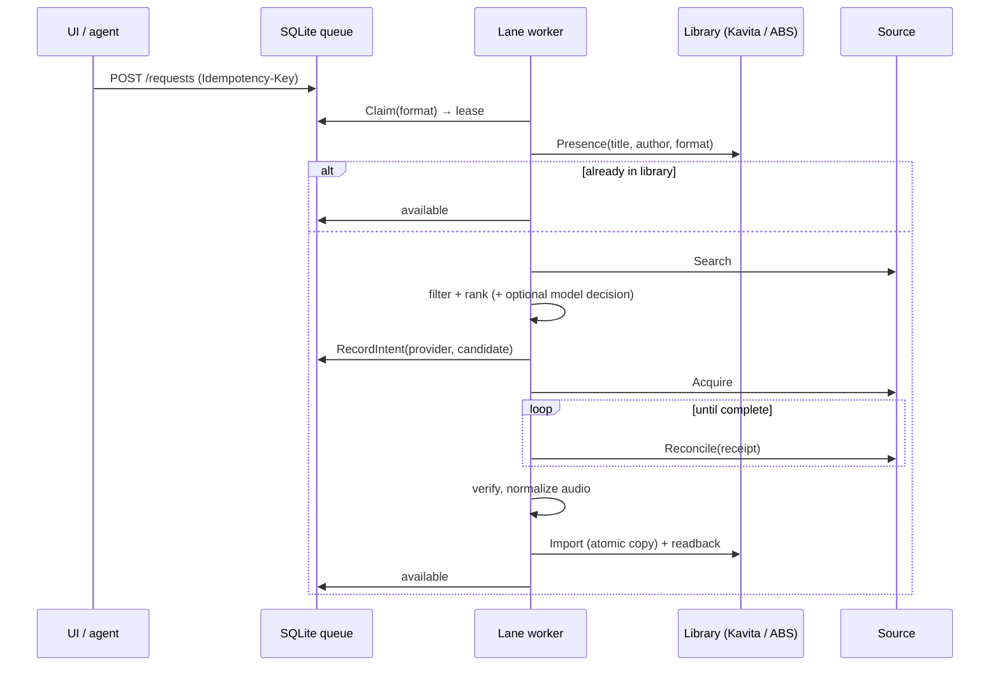

# Architecture

Arrdio is two services:

- **`backend/`**: a Go service that owns the queue, every source integration, file
  verification and library placement. It listens on `:2131` and is never exposed
  to browsers directly.
- **`frontend/`**: a Nuxt 4 app. Its server side handles Authentik/OIDC sign-in
  and forwards browser calls to the backend with a shared gateway token. A second,
  separately authenticated route (`/agent`) carries REST and MCP traffic from
  agents holding scoped grants.



## Data model

All state lives in one SQLite database in WAL mode (`ARRDIO_JOBS_DB`).

| Table | Role |
| --- | --- |
| `requests` | A work: title, author, kind (book or manga), volume, optional constraints. `identity` is a normalized key, so the same book requested twice is one request. |
| `representations` | One **job** per request and format (`ebook`, `audio`, `manga`), with state, `eligible_at`, lease token/expiry and attempt count. |
| `batches` | Idempotent intake: `(principal, key)` maps to a digest and stored result, so a retried upload never double-queues. |
| `transfer_intents` | The provider and candidate a job is about to acquire, written **before** the source call. |
| `job_details`, `candidate_choices`, `candidate_options` | The chosen candidate, receipts, and user overrides. |
| `job_stalls`, `failed_sources`, `failed_candidates`, `provider_backoff` | Retry bookkeeping (see below). |
| `accounts`, `reservations` | Encrypted credentials for direct-download sources and per-job allowance reservations. |
| `routing`, `placements`, `retained_files`, `conversions` | Library routes, published files, kept originals and M4B conversion state. |
| `grants`, `bootstraps` | Hashed agent grants and single-use pairing codes. |

Schema migrations are additive and versioned (`job_schema`). A database written by
a newer binary is refused.

## Workers and leases

`Runtime.Run` starts one worker per lane (ebook, audio, manga) on a 2-second tick,
plus background loops for photo extraction, metadata enrichment and account
refresh. Workers only dispatch when `ARRDIO_WORKERS=true`, so a fresh deployment
can be checked from Settings before it touches anything.

Each tick does two things:

1. **Resume.** Pick one job that already has a transfer intent (`transferring`,
   `importing`, `converting`, ...) and is due for a check, ordered by `eligible_at`.
   This polls the source's `Reconcile` and drives the job toward placement. It
   never calls `Acquire` again.
2. **Claim.** Atomically move the best eligible `queued` job to `matching` with a
   random lease token and a 10-minute lease. Ordering is: jobs that have never
   stalled first, then bump rank, then request rank (newest first). A job whose
   lease expires without finishing becomes claimable again.

Every state write checks the lease token, so a worker that lost its lease can't
overwrite the result of the worker that took over.

## Transfer intents and recovery

Some sources spend something when you call them: a daily download allowance, or
a torrent that starts consuming bandwidth. Before `Acquire`, the worker commits a
`transfer_intents` row in its own transaction. After a crash:

- an intent with a receipt resumes through `Reconcile`;
- an intent without one is re-prepared from the saved candidate (`PreparedSource`)
  so the remote identity, such as a torrent info-hash, is known;
- an `unresolved` intent is never dispatched again automatically. It stays
  visible until reconciled.

Sources signal failures with typed errors: `SafeFailure` (no external effect
happened, try the next candidate), `UnusableCandidate` (set this release aside for
30 days without penalizing the source), `RetryTransferFailure` and
`FinalTransferFailure`.

## Retries and backoff

`jobs/stall.go` handles retry timing for any outcome that made no progress:

- **Nothing found.** Retried after 1h, doubling up to 64h, with a final attempt
  seven days after the first failure. After that the job becomes `not_found` and
  leaves the queue. Retrying or re-requesting starts a fresh window.
- **Other stalls** (source busy, library not yet indexed, allowance exhausted):
  1 minute doubling to 1 hour.
- **Per-source backoff.** A source that refuses or rate-limits requests is silenced
  for that source only (`provider_backoff`). Other sources keep working.

Because never-stalled jobs are claimed first, a backlog of unfindable titles can't
starve new requests.

## Sources

```go
type Source interface {
    Name() string
    Search(ctx context.Context, in Input, format string) ([]Candidate, error)
    Acquire(ctx context.Context, c Candidate, dir string) (Receipt, error)
    Reconcile(ctx context.Context, r Receipt) (Receipt, error)
}
```

Built-in adapters live in `backend/providers/`:

| Adapter | Kind | Notes |
| --- | --- | --- |
| `Prowlarr` + `Torrent` | Indexer search, qBittorrent transfer | Discovers each indexer's categories, parses `[LANG / FORMAT]` release tags, adds torrents in automatic management mode, selects single volumes from packs, maps the client's paths. |
| `Soulseek` | P2P via slskd | Reads the peer's full folder inventory and checks track coverage before accepting a partial result set. |
| `ZLibrary` | Direct download | Encrypted shared accounts, allowance tracked per account, fresh-login validation for new credentials. |
| `ABB` | Web index + torrent | Paced HTML scraping with a member session; backs off for hours when refused. |

Sources are tried in the order configured in `backend/app/app.go`. To add one,
implement `Source` (and optionally `PreparedSource`), register it there, and add
its health state to `SetService`.

## Ranking

`providers.Rank` turns raw candidates into an ordered shortlist:

1. **Identity.** Every significant word of the requested title must appear
   (numbers included). One-letter spelling differences are allowed, and a dropped
   subtitle is accepted when the author agrees. Author matching compares each
   credited name and allows one edit for romanization (Yuto/Yuuto).
2. **Constraints.** Language, narrator, edition and container requirements are
   hard filters. Unknown facts don't satisfy a requirement.
3. **Variants last.** Summaries, companions, abridged, adapted and dramatized
   editions rank below the real work unless requested.
4. **Quality, then health.** Among releases with healthy swarms, the better
   container wins (M4B > M4A > MP3, EPUB > PDF, CBZ > CBR), then seeders.

If a decision model is configured (OpenRouter or a TypeSafe decisions endpoint),
it chooses among the ranked candidates under the same policy. It can only pick an
index from the list. A failure falls back to deterministic ranking and is shown in
Settings.

## Library placement

The `Library` interface has two methods, `Presence` and `Import`. The
`providers.Libraries` implementation talks to Kavita and Audiobookshelf:

- **Presence before download.** Each library's full series list is read in one
  page, then searched by series name. If that fails, it falls back to chapter-title
  lookup, since Kavita files some books under their series name. A failed lookup
  waits instead of downloading a duplicate.
- **Routing.** `routes.json` maps `{category, format, service, library_id, path}`.
  An uncategorized book whose format has several routes is classified once by the
  model into one of the configured categories. Ebooks are also offered manga
  routes, because manga volumes are often distributed as EPUB/PDF.
- **Naming.** Ebooks go to `Author/Title/Title (Author).epub`, manga to
  `Series/Series v01.cbz`, and single-file audiobooks to `Author/Title/Title.m4b`.
  An existing folder whose name differs only in case or punctuation is reused.
- **Atomic copies.** Files are verified and then copied into place via a temp
  file and rename. With `ARRDIO_LIBRARY_OWNER=uid:gid`, only what Arrdio creates
  is chowned.
- **Readback.** A job is `available` only when the library has indexed the
  placed file. A library scan is requested after import and coalesced per library.

Originals and seeding payloads are never deleted. Correction (choosing a different
release) replaces only files the same job previously published.

## Audio normalization

Multi-file audiobooks are combined into one M4B with FFmpeg: natural disc/track
order, chapters from track durations, title/author tags and cover art. AAC is
remuxed where possible; other codecs are encoded at `ARRDIO_AUDIO_BITRATE` (default
96k). The output duration must match the sources (at least one second of slack)
before it is published.

## Agent surface

The same queue is exposed three ways:

- **REST** under `/agent/...` with bearer grants (hashed at rest, scoped,
  revocable from Settings);
- **MCP** using the official Go SDK, with a small transport adapter for current and
  legacy protocol revisions;
- **CLI / skill bundle** (`backend/jobs/integration/`), a dependency-free Python
  client that pairs with a single-use 15-minute bootstrap code and can also act as
  an MCP stdio bridge.

Agents can queue, bump, cancel, retry, categorize, correct and read status. They
can't add or remove accounts or choose filesystem paths.
